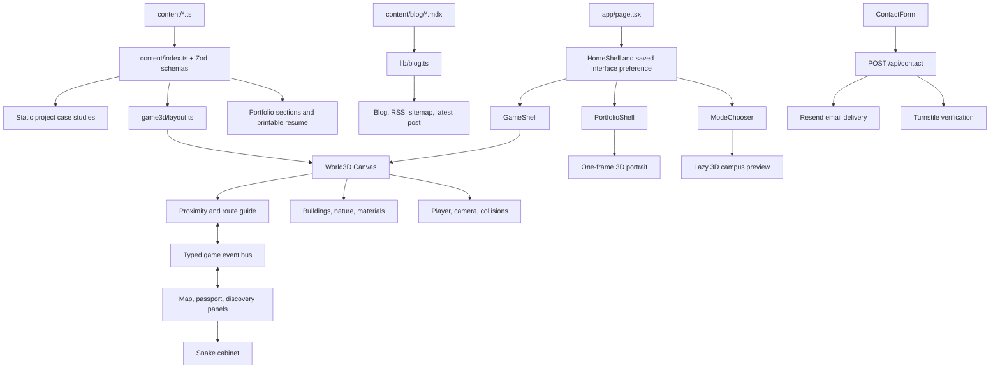

# Codebase map

Reviewed 2026-09-05. This maps the current working tree, including the initial redesign edits made before the full review. There are 90 TypeScript, TSX, and MDX files across `src`, `content`, and `scripts`, approximately 11,500 lines. Build output and dependencies are excluded. No credentials were read.

## Application and data flow

## Routes and rendering boundaries

| Route | Owner | Behavior |
| --- | --- | --- |
| `/` | `app/page.tsx`, `components/landing/*` | Server reads the latest blog entry; client restores a saved mode or displays the chooser. |
| Portfolio mode | `components/portfolio/portfolio-shell.tsx` | Lazy client interface with hero, about, experience, projects, skills, writing, contact, and footer. |
| Game mode | `components/game/game-shell.tsx`, `game3d/world.tsx` | Lazy client HUD and WebGL world. |
| `/resume` | `(classic)/resume/page.tsx` | Server-rendered full resume plus browser print control. |
| `/projects/[slug]` | `(classic)/projects/[slug]/page.tsx` | Five static case studies; unknown slugs rejected. |
| `/blog`, `/blog/[slug]` | `(classic)/blog/*`, `lib/blog.ts` | Filesystem MDX compiled at build time, one current post. |
| `/contact` | `(classic)/contact/page.tsx`, `contact-form.tsx` | Contact details and an optional Turnstile-protected form. |
| `/about`, `/projects`, `/experience` | Redirect stubs | Redirect to `/`, `/`, and `/resume` respectively. |
| `/api/contact` | `app/api/contact/route.ts` | Only dynamic write endpoint. |
| Sitemap, robots, RSS, OG image | `app/sitemap.ts`, `robots.ts`, `rss.xml`, `opengraph-image.tsx` | Build-time discovery and sharing surfaces. |

`app/layout.tsx` supplies three self-hosted next/font families, theme initialization, JSON-LD, metadata, and optional analytics. The `(classic)` layout supplies shared navigation and footer. Global styles own theme tokens, microinteractions, game chrome, and print rules.

## Content model

`content/schemas.ts` defines profiles, education, experience, projects, skills, certifications, world metadata, and blog frontmatter. The `@content` barrel validates all profile/resume entries at import time. Renderers must consume that barrel; TypeScript-only schema imports and the build-time blog frontmatter parser are separate.

Current content: 3 career entries (1 co-founder, 2 internships), 5 projects, 1 education entry, 4 skills categories, 2 certifications, and 1 blog post. The owner explicitly wants the existing name and social placeholders retained. Qualia's start date is also flagged by the existing content validator.

The current map exposes 20 navigable stops. Three are sourced campus landmarks from `content/campus.ts`: Duhig Tower, UQ Lakes, and the Dr Mary Mahoney AO Amphitheatre. The remaining destinations are generated from resume content plus the blog, contact, Snake, scholarship, and lookout interactions.

World positions derive from this content but use finite slots. Offices wrap after three completed-career slots, crystals after five; arcade positions extend linearly. Future content expansion must update space/collision planning rather than assume unlimited capacity.

## 3D ownership and dependencies

| Module | Responsibility and important coupling |
| --- | --- |
| `world.tsx` | Canvas, keyboard provider, two quality tiers, two lights, shadow classification, snapped sun frustum, boot completion, and composition. |
| `layout.ts` | Walkable union, building anchors, trees, lamps, content-to-world mapping, player blockers, camera blockers, interactables, and zone labels. Pure data, no Three.js import. |
| `state.ts` | Mutable player, motion, orbit, joystick, runtime and active-target state shared without frame-by-frame React updates. |
| `player.tsx` | Procedural character rig, movement, gait, jumping, body/head animation, dust, and camera follow. |
| `motion.ts` | Exponential damping, angle wrapping, and swept axis-separated movement. |
| `camera-controls.tsx` | Pointer capture, orbit, pinch/wheel zoom, camera reset, keyboard focus and blur handling. |
| `interactions.tsx` | Nearest destination, interaction key subscription, hints, and opening content. |
| `navigation.ts`, `route-guide.tsx` | Destination IDs, cached walkability grid, A* paths, route progress, detour recovery, and one instanced route-marker draw call. |
| `materials.ts` | Shared toon ramp, rounded geometry, sun direction/basis, contact shading, tile textures, and fallback shadow textures. |
| `authored-campus.tsx`, `authored-exhibits.tsx` | Authored campus architecture and the project gallery displays. |
| `welcome-plaza.tsx`, `skills-garden.tsx`, `lookout-island.tsx` | The arrival area, skills destination, and the far-bank lookout. |
| `nature.tsx` | Sky and water shaders, paths and ground, clouds, and instanced trees. |
| `camera-boom.ts`, `player-visibility.tsx` | Camera occupancy solver with recovery hysteresis and a single depth-tested player marker. Intervening scenery no longer forces the camera to zoom. |
| `signage.ts` | Shared wayfinding positions, undistorted 4:1 atlas tile proportions, padded UVs, and physical board dimensions. |
| `world-details.tsx` | Merged human-scale dressing: 19 static students, 4 wayfinding signs, 5 picnic tables, and framed planted beds. |
| `hero-diorama.tsx` | Chooser preview using the real Great Court plus nature modules, with offscreen and reduced-motion frame control. |
| `detect.ts` | Software-renderer detection via a temporary GL context. |
| `perf.ts`, `perf-probe.tsx` | Optional metrics state, renderer/shadow wrappers, GPU timers, and query parameters. |
| `target-ring.tsx` | Nearby-interaction ground marker. |

The core world and the chooser preview reuse the same large scenery modules. The portrait imports Three.js independently through a demand-rendered canvas. Therefore the old claim that all nongame interfaces ship zero Three.js is inaccurate; the full playable world is lazy, but previews still use rendering code.

## Scene budget and art direction

Existing constraints remain: sunny day, one directional shadow map, one hemisphere light, no point lights, no postprocessing, no runtime CDN assets. Current shadow tiers are DPR caps 1.35/1.5 with 1024/1536 maps, both shadowed. Trees, cabinets, crystals, clouds, and repeated architectural details use instancing; shared static shapes are merged. Sixteen static instance batches upload transforms once with `frames={1}`, animated foliage is capped at 30 Hz, and the software-GL probe caches its result for all three canvas entry points.

Do not lower the quality floor or promise a frame-rate gain without measurements. Historical numbers in the decision log describe earlier builds, not this working tree. The debug probe itself wraps rendering and issues GPU timer queries; it should be opt-in for ordinary previews.

Building changes must be reflected in camera collision volumes. Elevation also matters: the bridge deck and lookout are above the main ground; the player and route markers must use matching heights.

## UI, state, and lifecycle

- `game/bus.ts` carries discrete boot, panel, hint, route, discovery, and Snake events. Per-frame position stays out of React.
- `GameShell` owns loading, map, discovery, pause, context-error, and visibility states. It must be the single owner of gameplay pause composition.
- `BootBoardingPass` displays progress from chunk, GL context, compilation, and rendered frame. A timeout must offer an exit, never invent successful loading.
- `DialogPanel` resolves payload IDs against validated content. The redesign shows content immediately rather than forcing a typewriter delay.
- `world-map.tsx` caches base cartography and draws route/player state on a capped canvas loop; `map-overlay.tsx` provides accessible destination selection.
- `campus-guide.tsx` owns local passport persistence and route guidance display. The guide can unmount during overlays, so it must recover the selected route from shared navigation state.
- `touch-controls.tsx` writes joystick state, provides run/jump/discover controls, and must clear captured input on cancel, pause, or unmount.
- `SnakeGame` owns a separate fixed-tick canvas game. It must not leak keyboard input to the world.
- `use-dialog-focus.ts` traps Tab navigation and restores focus when a modal closes.
- `use-media-query.ts`, `ThemeToggle`, and `interface-mode.ts` manage media preferences and local UI settings.

Storage is local-only: interface preference, theme, Snake best score, and the new campus passport. No gameplay data is uploaded.

## Portfolio and shared components

- `sections/hero.tsx`: identity, availability, resume/work links, accurate derived counts, and character card.
- `sections/about.tsx`: narrative and profile facts.
- `sections/experience.tsx`: career and education entries with dates, highlights, and badges.
- `sections/projects.tsx`: featured cases, outcomes, and additional projects.
- `sections/skills.tsx`: actual technology categories replacing redundant counters.
- `sections/writing.tsx`, `contact.tsx`, `footer.tsx`: latest post, contact entry point, and Brisbane clock.
- `ticket.tsx`: section headings, monograms, availability dot.
- `character-portrait.tsx`: a static duplicate of the character mesh design. Changes to character appearance require updating both representations.
- `badges.tsx`, `mdx-components.tsx`, `print-button.tsx`, `site-nav.tsx`, and `site-footer.tsx`: shared deep-page presentation.
- `fx/reveal.tsx`, `counter.tsx`, and `ticker.tsx`: motion primitives. Their JavaScript animations need explicit reduced-motion handling; global CSS alone cannot stop Motion values.

## Server, security, build, and deployment

`POST /api/contact` validates JSON and size, checks a honeypot, verifies Turnstile, and sends email using fetch. Production fails closed when captcha or delivery configuration is missing. UI testing must not send a real message. No changes to email delivery are needed for this redesign.

`next.config.ts` owns CSP/security headers, unoptimized images, and the optional separate build directory. The code supports Next.js hosting and Cloudflare Workers through OpenNext. `open-next.config.ts` and `wrangler.jsonc` define that adapter. Existing documentation records Windows symlink restrictions; Linux CI runs both builds.

`package-lock.json` and declared dependencies are preserved. `.github/workflows/ci.yml` validates content, lints, typechecks, builds both targets, and reports dependency audit results. The repository already had substantial uncommitted work before this request; no reset, broad cleanup, or commit should absorb it.

## Resolved implementation status

- Game pause, focus loss, overlay ownership, re-entry, and input cleanup share one lifecycle model.
- Player, route markers, bridge, amphitheatre steps, and lookout use shared surface heights.
- Player and camera collision volumes cover the expanded campus, rotated wings, roofs, awnings, furniture, and pergola while preserving intended entrances and canopy clearance.
- Performance instrumentation is opt-in with `?perf`; hidden or covered gameplay pauses, static instance batches upload once, and foliage animation runs at 30 Hz.
- Project accents, deep-page mode links, JavaScript reduced-motion behavior, and the shared world-map paths are aligned with their current rendering sources.
- Snake handles vacating-tail movement, a full board, self and wall collisions, queued turns, and document visibility.
- Mixed indexed and non-indexed procedural meshes normalize through `mergeSceneGeometry`, which throws on incompatible attributes instead of silently dropping geometry.
- Architecture, privacy, content, and deployment notes reflect the current two-interface implementation. Requested profile and Qualia placeholders remain explicitly reported by validation.

## Final verification

- `validate:content`, ESLint, TypeScript, and the deterministic world/geometry suite pass.
- The world suite checks all 60 routes from the plaza, Great Court, and lookout; segment clearance; map/content identity; collision sweeps; camera roofs and awnings; terrain heights; damping invariance; geometry normalization; and Snake edge cases.
- Final Next production build passed on 2026-09-06, including TypeScript and all 20 static pages, as the first stage of the isolated Cloudflare build.
- Cloudflare reached server bundle generation after the same successful Next build, then Windows denied creation of a `next-mdx-remote` symlink with `EPERM`. Full Workers packaging remains unverified on this host. The optional `OPEN_NEXT_BUILD_OUTPUT_PATH` configuration fixes the earlier custom-directory mismatch while preserving ordinary CI/deployment defaults.
- HTTP smoke checks cover the root, resume, a project detail, blog, contact, sitemap, and redirect routes without submitting the contact form.
- Development-server HTTP smoke on 2026-09-05 returned 200 for `/`, `/resume`, `/projects/hull-ship-inspector`, `/blog/building-this-site`, `/contact`, `/sitemap.xml`, and `/rss.xml`. `/about` and `/projects` returned 308 to `/`; `/experience` returned 308 to `/resume`. No form was submitted.
- Browser rendering, frame-rate measurements, and print-page visual inspection require a separately authorized browser playtest. Source review and deterministic tests do not substitute for them.
